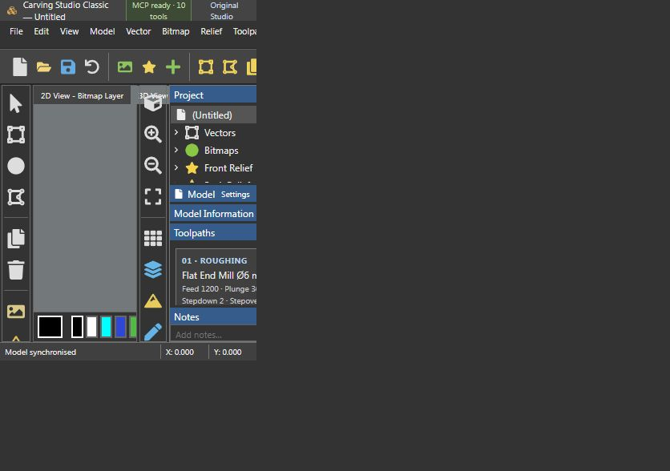

# Carving Studio — Classic + Original

โปรแกรมออกแบบงาน CNC แบบทดลอง พร้อมหน้าตาแนว ArtCAM และ MCP สำหรับ AI ที่รองรับ local stdio MCP



## ติดตั้งและเปิด

ต้องมี Node.js 22 ขึ้นไปและ npm จากนั้นเปิดเทอร์มินัลในโฟลเดอร์ carving-studio:

```sh
npm ci --prefix artcam-classic
npm --prefix artcam-classic run dev
```

เปิด http://127.0.0.1:4318/ สำหรับ Classic หรือรัน `npm start` ที่โฟลเดอร์นี้เพื่อเปิด Original ที่ http://127.0.0.1:4317/

บน Windows ใช้ Setup.cmd ครั้งแรก แล้วเปิด Start-ArtCAM-Classic.cmd หรือ Start-Carving-Studio.cmd

แอป MCP ต้องรัน Node.js ในเครื่อง ไม่ใช่เปิดบน GitHub Pages โดยตรง แอปเดิมใน repo นี้ยังอยู่ที่เดิม

## MCP สำหรับ AI

รัน `npm --prefix artcam-classic run mcp:config` เพื่อสร้าง artcam-classic/mcp-config.json ตามที่ติดตั้งจริง แล้วเพิ่ม entry นี้ในไคลเอนต์ AI ที่รองรับ MCP stdio หรือกด MCP ready บนหน้าจอ Classic เพื่อดาวน์โหลดไฟล์ตั้งค่า

มี 10 tools: get_model, new_model, add_vector, update_vector, delete_vector, set_parameters, create_relief, calculate_toolpath, set_view, export_model ไคลเอนต์ที่ไม่รองรับ MCP หรือเข้าถึงเครื่องนี้ไม่ได้จะเชื่อมตรงไม่ได้ ยังไม่มี remote MCP endpoint

## ฟังก์ชัน

- วาด/ย้าย/แก้ขนาด rectangle, circle, polyline, undo, สี, zoom/grid
- SVG รูปทรงพื้นฐาน → DXF, ภาพหรือเวกเตอร์ปิด → height-field relief → STL
- พรีวิวกัดตามเส้น, raster roughing และ ballnose finishing แบบทดลอง
- เซฟ/เปิด JSON และซิงก์งานระหว่าง UI กับ AI
- Original เก็บแยกใน public/ และ Classic ใน artcam-classic/

ไม่ใช่ Autodesk ArtCAM และยังไม่มี native ART import, แปรงปั้นอิสระ, pocketing, V-carving, simulation เนื้อวัสดุ, การควบคุมเครื่องหรือระบบใบอนุญาต ArtCAM

## ตัวอย่างและทดสอบ

ดู [ลายไทยและเครื่องมือกัด](examples/thai-kanok/README.md)

```sh
npm --prefix artcam-classic test
npm --prefix artcam-classic run build
# เมื่อ Classic เปิดอยู่: สร้างเดโมใหม่ผ่าน MCP (สำรองโมเดลก่อนแทนที่)
npm --prefix artcam-classic run demo:thai
```

STL เป็นลายนูนสูง 0–6 mm พร้อมฐานที่ Z=-1 mm; ทางกัดทดลองใช้ stock-top Z=0 และเลื่อนผิวลง 6 mm ต้องตรวจพิกัดและดอกกัดแยกก่อนใช้งานจริง การคำนวณเป็น discrete raster envelope ไม่รับรองการหลบแคลมป์/หัวจับหรือความเหมาะสมของ feed ต่อวัสดุ Relief G-code export ยังปิดอยู่

## ข้อมูลในเครื่อง

ไม่มี node_modules, runtime, ไฟล์สถานะงานส่วนตัว, machine-specific MCP config, log หรือไฟล์ Autodesk/REA รวมอยู่ ชุดตัวอย่างเป็นงานที่สร้างขึ้นในโครงการนี้
