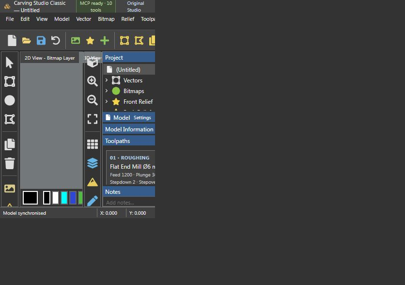

# Thai kanok-inspired relief demo

200 × 220 mm, 6 mm relief height, 193 × 193 height samples. Open project.json in Classic for the geometry/relief. Tool presets are recorded in tool-presets.json.

Run `npm run demo:thai` from ../../artcam-classic while Classic is running to reproduce the full demo through MCP and generate STL/DXF/project files under ../../research/thai-demo. The demo backs up the current model before replacing it.

Roughing: flat End Mill Ø6 mm, stepdown 2 mm, stepover 2.4 mm, allowance 0.5 mm. Finishing: Ball Nose Ø3 mm, stepover 0.6 mm. These are experimental raster previews; no machine-ready relief G-code is exported. No CNC machine was run.
